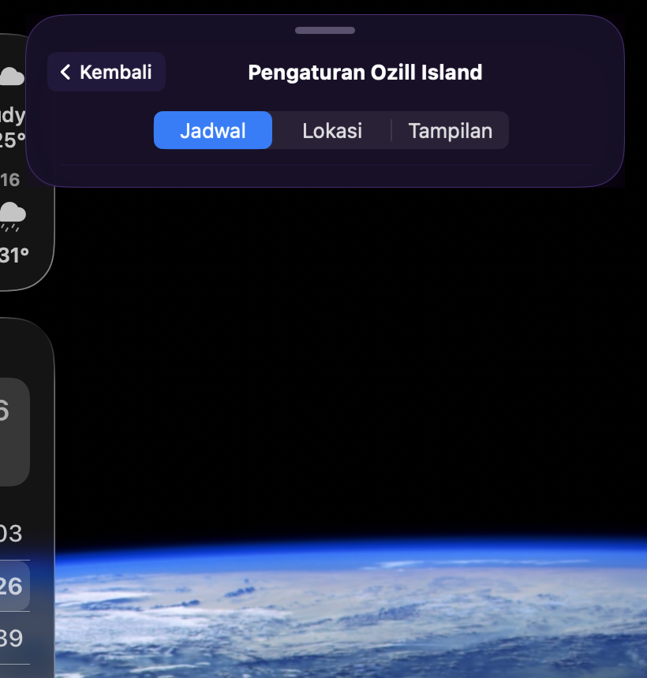

# 🏝️ Ozill Island — Dynamic Island Pintar untuk Mac

> **Dynamic Island pintar, elegan, & serba bisa untuk macOS** yang melayang di layar Mac Anda. Menampilkan hitung mundur waktu shalat otomatis berstandar resmi Kemenag RI, memunculkan notifikasi aplikasi chatting (WhatsApp, Telegram, Instagram, Mail, dll.), kontrol musik & volume, pengatur kecerahan layar, utilitas screenshot, timer fokus fleksibel, efek petir (*Lightning Border*), dan posisinya **bisa digeser bebas ke mana saja**!

---

## 📸 Cuplikan Tampilan (Media Preview)

|               Tampilan Utama (Pill Ringkas)                |              Notifikasi Masuk (WhatsApp / IG / dll)              |
| :--------------------------------------------------------: | :--------------------------------------------------------------: |
|  |  |

|                 Menu Lengkap (Expanded Hub)                  |           Pengaturan & Kustomisasi (Settings)            |
| :----------------------------------------------------------: | :------------------------------------------------------: |
|  |  |

---

## ✨ Fitur-Fitur Unggulan

- 🕌 **Jadwal Shalat & Adzan Akurat**: Menggunakan hisab falak astronomis resmi standar Kemenag RI (100% offline, otomatis mendeteksi lokasi GPS atau pilih kota manual se-Indonesia).
- 💬 **Universal Notifikasi Aplikasi (Anti-Spam)**: Pesan dari WhatsApp, Instagram, Telegram, Slack, Mail, Discord, Messages/SMS langsung tampil anggun di pulau melayang. Dilengkapi filter pintar yang **memblokir 100% derau sistem** (seperti spam jam, kalender, atau widget macOS).
- 🎵 **Media Player & Audio Controller**:
  - Pantau lagu aktif dari Spotify, Apple Music, hingga YouTube / YouTube Music di peramban.
  - Tombol lengkap: *Previous*, *Play/Pause*, dan *Next*.
  - Visualizer gelombang suara dinamis (*Music Waveform*) yang bergerak mulus tanpa macet.
  - Slider volume sistem interaktif dengan tombol mute instan.
- ⏱️ **Focus & Pomodoro Timer Fleksibel**:
  - Atur durasi waktu fokus kerja atau istirahat sesuka Anda menggunakan kontrol stepper cepat (`-5m`, `-1m`, `+1m`, `+5m` hingga 180 menit).
- 💡 **Display Brightness Control**:
  - Atur tingkat kecerahan layar MacBook langsung dari Island tanpa perlu membuka System Settings.
- 🚀 **Quick Actions & Screenshot Utility**:
  - Peluncur Safari sekali klik.
  - Tangkap layar instan dengan pilihan mode: **Layar Penuh (Full Screen)**, **Area Pilihan (Area Selection)**, atau **Jendela Aplikasi (Window Selection)** langsung tersalin ke clipboard atau tersimpan ke folder Pictures.
- ⚡ **Lightning Border Effect**:
  - Efek kilatan petir neon bertegangan tinggi di sekeliling pinggiran melengkung (*round perimeter*) Island yang memukau. Tetap hemat daya (otomatis jeda dan 0% CPU saat idle).
- 🔀 **Drag & Drop Urutan Kartu**:
  - Bebas mengatur urutan kartu kontrol (Media & Audio, Timer, Kecerahan, Quick Actions) sesuai kenyamanan Anda cukup dengan menarik (*drag and drop*) handle kartu.
- 🖐️ **Bebas Digeser (Draggable di Semua Mode)**:
  - Mau ditaruh di tengah, pojok kiri, pojok kanan, atau di bawah notch? Cukup klik dan geser!
  - Bisa digeser baik saat mode **Pill kecil** maupun saat menu **Expanded Hub terbuka lebar** melalui *Top Mover Bar* atau area judul header.
- 🎯 **Kembali ke Tengah Sekali Klik**: Tersedia tombol reset (🎯) jika ingin mengembalikan pulau ke posisi tengah atas layar secara simetris.
- 🎨 **Pilihan Tema Warna & Kontras Tinggi**: Sesuaikan tampilan dengan gaya favorit Anda (Default Dark, Cyber Glow, Emerald, Sunset, Midnight, atau Pearl Light yang kontras dan bersih).

---

## 📥 Panduan Instalasi (Untuk Pemula / Orang Awam)

Tidak perlu paham koding atau terminal! Ikuti langkah-langkah mudah berikut:

### Langkah 1: Pindahkan Aplikasi ke Folder Applications

1. Temukan file aplikasi **`OzillIsland.app`** (bisa didapatkan di folder `build/` atau dari file unduhan rilis).
2. **Seret (drag & drop)** file `OzillIsland.app` ke dalam folder **Applications** (Aplikasi) di Mac Anda.

---

### Langkah 2: Buka Aplikasi Pertama Kali

1. Buka folder **Applications** lalu **klik 2 kali** pada icon `OzillIsland`.
2. *Jika muncul pemberitahuan keamanan:* *"OzillIsland cannot be opened because it is from an unidentified developer"*:
   - Klik kanan (atau tahan tombol `Control` lalu klik) pada icon `OzillIsland`.
   - Pilih **Open** (Buka).
   - Di jendela konfirmasi yang muncul, klik **Open** sekali lagi. Langkah ini hanya perlu dilakukan satu kali saat pertama membuka.

---

### Langkah 3: Beri Izin Aksesibilitas (PENTING untuk Notifikasi)

Agar notifikasi dari WhatsApp, Telegram, dan aplikasi pesan lainnya dapat diteruskan ke Dynamic Island, macOS memerlukan izin **Aksesibilitas (Accessibility)**:

1. Buka **System Settings** (Pengaturan Sistem) di Mac Anda.
2. Pilih menu **Privacy & Security** (Privasi & Keamanan) di bilah kiri.
3. Klik pada opsi **Accessibility** (Aksesibilitas).
4. Klik tombol **`+`** (tambah), lalu pilih aplikasi **OzillIsland** dari folder *Applications*.
5. Pastikan tombol sakelar (toggle) di samping **OzillIsland** sudah menyala **ON (Warna Biru)**.

> 💡 **Tips Cepat:** Di tab Pengaturan Ozill Island (ikon gerigi ⚙️), Anda bisa langsung menekan tombol **"Buka Pengaturan"** untuk langsung menuju halaman izin tersebut dan menekan tombol **"Cek Status"** untuk memverifikasi.

---

### Langkah 4: Beri Izin Lokasi & Perekaman Layar (Opsional)

1. **Izin Lokasi**: Pilih **"Allow While Using App"** agar jadwal shalat offline otomatis menyesuaikan koordinat lintang/bujur kota Anda.
2. **Izin Screen Recording (TCC)**: Diperlukan jika Anda ingin menggunakan fitur utilitas screenshot area/jendela dari Quick Controls.

---

### Langkah 5: Otomatis Nyala Saat Mac Dihidupkan

Agar Anda tidak perlu membuka aplikasi secara manual setiap kali menyalakan Mac:
1. Buka pulau (klik Island) > Buka Pengaturan (⚙️) > Tab **Tampilan**.
2. Nyalakan toggle **"Buka Otomatis saat Login"**.

---

## 🎮 Cara Menggunakan Ozill Island

### 1. Navigasi 3 Tab Utama (Expanded Hub)

Klik satu kali pada pill Island di layar untuk membuka Hub menu lengkap:
- **🕋 Shalat**: Menampilkan hitung mundur waktu shalat terdekat, jadwal 5 waktu shalat hari ini + Syuruq, dan indikator audio adzan.
- **🎛️ Controls**: Pusat kontrol terpadu yang memuat:
  - *Pemutar Media & Volume*: Cover art album, judul lagu, musisi, tombol prev/play/next, baris multi-tab browser, dan slider volume sistem.
  - *Focus & Pomodoro Timer*: Display hitungan mundur digital dengan tombol stepper durasi bebas (`-5m`, `-1m`, `+1m`, `+5m`).
  - *Kecerahan Layar*: Slider kecerahan display internal Mac.
  - *Quick Actions*: Tombol pintas Safari dan alat Screenshot instan.
- **ℹ️ Info**: Status memori, baterai, prosesor, dan informasi sistem Mac Anda.

### 2. Menggeser Posisi Island (Bisa ke Mana Saja!)

- **Saat Mode Pill (Mengecil)**: Klik dan tahan di area pill, lalu geser ke posisi layar mana saja yang Anda suka.
- **Saat Mode Hub (Membesar)**: Klik dan tahan pada **Top Mover Bar** di bagian paling atas atau di area judul header, lalu geser secara bebas.
- Posisi baru akan **otomatis tersimpan secara permanen**, sehingga posisinya tidak akan hilang meskipun Mac direstart.

### 3. Mengatur Urutan Kartu Kontrol (Drag & Drop)

- Buka tab **Controls**.
- Pada setiap kartu (Media, Timer, Kecerahan, Quick Actions), tahan icon garis tiga (`line.3.horizontal`) lalu geser ke atas atau ke bawah untuk menyusun urutan tampilan kartu sesuai selera.
- Tersedia tombol **"Reset Urutan"** untuk mengembalikan tata letak ke konfigurasi awal kapan saja.

### 4. Mengembalikan Posisi ke Tengah Layar

- Ingin mengembalikan pulau ke posisi tengah simetris di bawah kamera/notch?
- Cukup buka menu Island, lalu klik icon target **`🎯`** di header atau di Pengaturan. Pulau akan langsung kembali ke posisi tengah atas.

### 5. Mengatur Efek Petir (Lightning Border)

- Masuk ke menu **Pengaturan (⚙️)** > Tab **Tampilan**.
- Aktifkan atau matikan sakelar **"⚡ Efek Lightning Border"** untuk menampilkan aura petir neon dinamis di sekeliling pinggiran melengkung Island.

---

## ❓ Solusi Masalah (Troubleshooting & FAQ)

### Apa yang harus dilakukan jika pulau macet atau posisinya tidak sengaja tergeser terlalu jauh?

1. **Gunakan Ikon Menu Bar (🌙)**:
   Di pojok kanan atas menu bar Mac Anda selalu ada ikon bulan bintang. Ikon ini berjalan secara terpisah dan **tidak akan pernah ikut macet**. Klik ikon **🌙** lalu pilih **Reset Posisi ke Tengah** atau pilih **Keluar (Quit)** untuk me-restart aplikasi.
2. **Restart Instan via Terminal (Untuk Pengguna Mahir)**:
   ```bash
   pkill -f OzillIsland && open build/OzillIsland.app
   ```
3. **Reset Koordinat Posisi Bawaan Pabrik**:
   ```bash
   defaults delete com.fauzi.ozillisland OzillIsland_UserOffsetX 2>/dev/null
   defaults delete com.fauzi.ozillisland OzillIsland_UserOffsetY 2>/dev/null
   ```

---

## 🗑️ Panduan Menghapus Aplikasi (Uninstall)

Jika Anda ingin mencopot aplikasi ini secara bersih:

1. Tutup aplikasi melalui menu bar atas: Klik icon **🌙** > Pilih **Keluar (Quit)**.
2. Buka **Finder** > Masuk ke folder **Applications**.
3. Tarik file **`OzillIsland.app`** ke **Trash** (Tong Sampah), lalu kosongkan tong sampah.
4. Buka **System Settings** > **Privacy & Security** > **Accessibility**, pilih **OzillIsland**, lalu klik tombol tanda minus **`-`**.

---

## 🧑‍💻 Khusus Developer & Kompilasi Mandiri

### Kebutuhan Lingkungan

- **macOS:** macOS 13.0 (Ventura), 14.0 (Sonoma), atau lebih baru.
- **Arsitektur:** Native Intel x86_64 dan Apple Silicon (Universal Binary).
- **Swift:** Swift 5.9+.

### Perintah Build & Validasi

```bash
# 1. Clone repository
git clone https://github.com/username/dynamic-island-mac.git
cd "Dynamic Island by Fauzi"

# 2. Build dan packaging bundle OzillIsland.app produksi
./scripts/build_app.sh

# 3. Jalankan aplikasi hasil packaging
open build/OzillIsland.app

# 4. Jalankan rangkaian pengujian otomatis (44 automated test assertions)
swift run OzillValidator
```

---

## 📄 Lisensi & Kredit

- **Kreator & Pengembang**: Fauzi Abdilah
- **Standar Hisab Falak**: Kementerian Agama Republik Indonesia (Kemenag RI) Madhab Syafi'i.
- Dibuat dengan penuh dedikasi untuk menghadirkan pengalaman Dynamic Island terbaik dan paling fungsional bagi pengguna Mac di Indonesia. 🇮🇩
