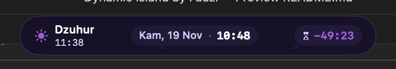
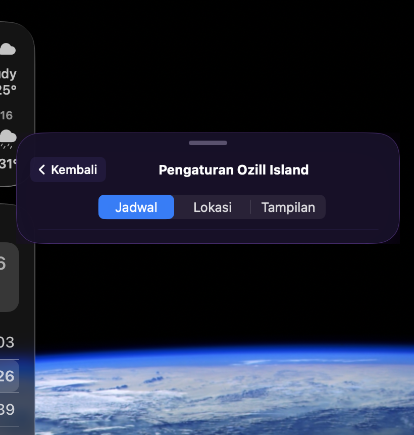

# 🏝️ Ozill Island

<p align="center">
  
</p>

<p align="center">
  <strong>An elegant, smart, and fully customizable Dynamic Island experience for macOS.</strong><br>
  Built with Swift, SwiftUI, and AppKit • Offline Astronomical Prayer Engine • Universal Notification Island • Touch Bar & Quick Controls • Media Player • Lightning Aura
</p>

<p align="center">
  
  
  
  
  
</p>

---

## 📸 Media Preview

|                  Collapsed Pill (Default)                  |              Active Notification (WhatsApp / Slack)              |
| :--------------------------------------------------------: | :--------------------------------------------------------------: |
|  |  |

|                Expanded Hub (Controls Sheet)                 |              Settings & Customization Sheet              |
| :----------------------------------------------------------: | :------------------------------------------------------: |
|  |  |

---

## 📑 Table of Contents

- [Overview](#-overview)
- [Feature Highlights](#-feature-highlights)
- [System Requirements & Architecture](#-system-requirements--architecture)
- [macOS Permissions Guide](#-macos-permissions-guide)
- [User Guide](#-user-guide)
  - [Navigation & Tabs](#1-navigation--tabs)
  - [Positioning & Free-Drag Mobility](#2-positioning--free-drag-mobility)
  - [Customizing Controls Order (Drag & Drop)](#3-customizing-controls-order-drag--drop)
  - [Focus & Pomodoro Timer](#4-focus--pomodoro-timer)
  - [Display Brightness & Volume Control](#5-display-brightness--volume-control)
  - [Screenshot Utility](#6-screenshot-utility)
  - [Lightning Border Effect](#7-lightning-border-effect)
  - [Themes & Appearance](#8-themes--appearance)
- [Supported Applications & Browsers](#-supported-applications--browsers)
- [Known Limitations](#-known-limitations)
- [Troubleshooting & FAQ](#-troubleshooting--faq)
- [Panduan Pengguna (Bahasa Indonesia)](#-panduan-pengguna-bahasa-indonesia)
- [Developer Setup & Build Commands](#-developer-setup--build-commands)
- [Project Architecture](#-project-architecture)
- [Privacy & Security](#-privacy--security)
- [Roadmap](#-roadmap)
- [License & Credits](#-license--credits)

---

## 🌟 Overview

**Ozill Island** is a floating dynamic status bar and productivity controller engineered specifically for macOS. Living just beneath your MacBook's notch or menu bar, it transforms your screen into an interactive command hub:

1. **Astronomical Prayer Engine**: 100% offline hisab falak calculation matching official Kementerian Agama RI (Kemenag) standards with zero external network requests.
2. **Universal Notification Island**: Captures incoming messages from communication apps (WhatsApp, Telegram, Slack, Mail, Messages, etc.) while blocking system widget noise.
3. **Compact Touch Bar & Quick Controls**: Unified media player with continuous waveform visualizer, display brightness slider, system volume control, Safari quick launch, and screen capture tools.
4. **Customizable & Draggable**: Freely drag the Island anywhere across the screen, reorder control cards with native drag-and-drop, and switch between rich OLED dark and light contrast themes.

---

## ✨ Feature Highlights

| Module                        | Implementation Status | Description                                                                                                                                          |
| :---------------------------- | :-------------------: | :--------------------------------------------------------------------------------------------------------------------------------------------------- |
| **Hisab Falak Prayer Engine** |     ✅ Production     | Offline astronomical solar position calculation (Adhan Swift 1.5.0) calibrated with official Kemenag RI SIHAT archives (+2m to +3m ihtiyati buffer). |
| **Universal Notifications**   |     ✅ Production     | Low-latency macOS Accessibility window inspection with strict noise filtering (blocks clock, calendar, weather, and widget popups).                  |
| **Media Player & Controls**   |     ✅ Production     | Apple Music, Spotify, and browser multi-tab routing (Chrome, Safari, Edge) with continuous sinusoidal waveform visualizer.                           |
| **Focus & Pomodoro Timer**    |     ✅ Production     | Freely adjustable minute duration (`-5m`, `-1m`, `+1m`, `+5m` up to 180m) with digital countdown display.                                            |
| **Display Brightness**        |     ✅ Production     | Built-in MacBook screen backlight control via native Apple IOKit Graphics bridge.                                                                    |
| **System Volume Control**     |     ✅ Production     | Direct AppleScript hardware output volume slider with single-click mute toggle.                                                                      |
| **Screenshot Utility**        |     ✅ Production     | ScreenCaptureKit-powered screen capture (Full Screen, Area Selection, Window Selection) saving directly to Desktop.                                  |
| **Lightning Border Effect**   |     ✅ Production     | High-voltage neon plasma arc border that dynamically wraps around the Island curve; pauses during idle dimming (0% CPU).                             |
| **Free-Drag Mobility**        |     ✅ Production     | Drag the Island across your display in both collapsed pill and expanded sheet states; persistent coordinate saving.                                  |
| **Card Drag & Drop Reorder**  |     ✅ Production     | Customize the vertical arrangement of Quick Controls cards with smooth drop animations.                                                              |
| **Theme Engine**              |     ✅ Production     | 5 color presets (Midnight OLED, Pearl Light, Emerald Islamic Green, Aurora Navy, System Adaptive) with custom accent color picker.                   |

---

## 💻 System Requirements & Architecture

- **Minimum Operating System**: macOS 13.0 (Ventura) or newer (macOS 14 Sonoma & macOS 15 Sequoia supported).
- **Architecture**: Native **Intel 64-bit (`x86_64`)**. Apple Silicon Macs (M1/M2/M3/M4) run seamlessly via Rosetta 2 translation _(Universal Binary arm64 compilation is planned)_.
- **Swift Version**: Swift 5.9+ (Swift Package Manager).
- **Process Model**: `LSUIElement = true` (Runs as a menu bar agent application without Dock clutter).
- **Window Level**: Native AppKit `NSPanel` floating at `.floating` level with `.canJoinAllSpaces` and `.fullScreenAuxiliary`.

---

## 🔐 macOS Permissions Guide

Ozill Island operates with a strict **privacy-first local architecture**. It only requests permissions strictly necessary for its features:

| Permission                                  | Feature                 | Why It Is Needed                                                                                               | What Happens If Denied                                                       |
| :------------------------------------------ | :---------------------- | :------------------------------------------------------------------------------------------------------------- | :--------------------------------------------------------------------------- |
| **Accessibility** (`AXIsProcessTrusted`)    | Universal Notifications | Reads window titles and message snippets from notification banners dispatched by apps like WhatsApp and Slack. | Incoming message banners cannot be rendered inside the Island.               |
| **Location Services** (`CLLocationManager`) | Prayer Schedule         | Automatically determines latitude, longitude, and timezone to calculate local prayer times.                    | Falls back to offline saved city presets (default: DKI Jakarta).             |
| **Screen Recording** (`ScreenCaptureKit`)   | Screenshot Utility      | Captures pixel buffers from full screen, selected windows, or user-selected areas.                             | Screenshot feature fails with a permission warning prompt.                   |
| **Automation** (Apple Events)               | Media Player & Volume   | Controls third-party media players (Spotify, Chrome tabs, Safari tabs) and system volume via AppleScript.      | Playback and tab tracking will be unavailable for that specific browser/app. |

---

## 🎮 User Guide

### 1. Navigation & Tabs

Click anywhere on the collapsed Island pill to expand the **Expanded Hub**, organized into 3 streamlined tabs:

- **🕋 Shalat**: Displays the next prayer countdown, complete daily prayer schedule (Subuh, Syuruq, Dzuhur, Ashar, Maghrib, Isya), and adzan notification audio status.
- **🎛️ Controls**: Hosts all compact Touch Bar controls: Now Playing media card, Focus Pomodoro timer, brightness slider, system volume slider, Safari launcher, and screenshot tools.
- **ℹ️ Info**: Real-time Mac hardware telemetry (CPU, RAM usage, battery health, and system uptime).

### 2. Positioning & Free-Drag Mobility

- **Collapsed Pill**: Click and drag the pill to position it anywhere on your desktop.
- **Expanded Hub**: Click and hold the dedicated **Top Mover Bar** (labeled with grip handles) or click and drag anywhere on the header title area.
- **Persistent Coordinates**: Window coordinates are saved automatically in `UserDefaults`.
- **One-Click Centering**: Click the target icon (**`🎯`**) in the header or in Settings to immediately snap the Island back to the center notch alignment.

### 3. Customizing Controls Order (Drag & Drop)

In the **Controls** tab, every card (Media & Volume, Focus Timer, Brightness, Quick Actions) features a drag grip icon (`line.3.horizontal`). Click and drag any card vertically to reorder them to your liking. Click **"Reset Urutan"** to revert to the default order.

### 4. Focus & Pomodoro Timer

Customize your focus session duration directly on the card:

- Use `-5m` and `+5m` buttons for quick 5-minute adjustments.
- Use `−` and `+` buttons for precise 1-minute steps.
- Click **Mulai** / **Jeda** to run or pause the countdown.
- Supports durations from **1 minute up to 180 minutes**.

### 5. Display Brightness & Volume Control

- **Display Brightness**: Smooth slider for adjusting MacBook built-in screen backlight in real-time.
- **System Volume**: Integrated slider controlling macOS master output volume with a single-click mute toggle.

### 6. Screenshot Utility

Tap the screenshot utility button to select your capture mode:

- **Layar Penuh (Full Screen)**: Captures the entire display immediately.
- **Area Pilihan (Area Selection)**: Interactive crosshair selection.
- **Jendela Aplikasi (Window Selection)**: Captures a specific application window with clean drop shadow.
- **Save Destination**: Images are exported as clean PNG files directly to your **Desktop** (`~/Desktop`) and simultaneously copied to your **Clipboard**.

### 7. Lightning Border Effect

A high-voltage neon plasma gradient that circles the rounded perimeter of the Island:

- Multi-layer rendering with electric bloom glow and animated spark discharges.
- Automatically pauses when the Island enters idle dimming (>15 minutes of user inactivity), ensuring **zero unnecessary CPU/GPU battery drain**.
- Can be toggled On/Off in **Pengaturan ➔ Tampilan**.

### 8. Themes & Appearance

Customize the Island's aesthetic in **Pengaturan ➔ Tampilan**:

- **Midnight**: True OLED pitch-black background (`#000000`).
- **Pearl**: Clean, high-contrast light theme with dark text and borders (`#FFFFFF`).
- **Emerald**: Deep Islamic botanical forest green (`#061A12`).
- **Aurora**: Cosmic navy slate background (`#0A0F1D`).
- **System**: Automatically matches your macOS Dark/Light Mode appearance.
- **Accent Color**: Choose between Emerald Cyan, Gold, Sky Blue, Rose, Violet, or a custom HEX code.

---

## 🌐 Supported Applications & Browsers

### Communication Apps (Notifications)

Ozill Island intercepts and parses incoming notification alerts from:

- **Messaging**: WhatsApp, Telegram, Slack, Discord, Apple Messages (iMessage / SMS), LINE, WeChat.
- **Social & Email**: Instagram, Twitter / X, Apple Mail, Gmail, Microsoft Outlook.
- **Collaboration**: Microsoft Teams, Zoom.

### Media Players & Web Browsers

- **Native Players**: Apple Music (`com.apple.Music`), Spotify (`com.spotify.client`).
- **Web Browsers**:
  - **Google Chrome**: Full media detection, YouTube / YouTube Music session tracking, play/pause, next, previous. _(Requires "Allow JavaScript from Apple Events")_.
  - **Apple Safari**: Supported via AppleScript DOM bridge. _(Requires "Allow JavaScript from Apple Events" in Safari Develop Menu)_.
  - **Microsoft Edge**: Full Chromium-based AppleScript support.
  - **Mozilla Firefox**: _See Known Limitations below_.

---

## ⚠️ Known Limitations

To maintain full transparency, here are the technical boundaries governed by macOS system architecture:

| Component                        | Limitation                                                      | Technical Reason                                                                                                                       | Workaround                                                                                      |
| :------------------------------- | :-------------------------------------------------------------- | :------------------------------------------------------------------------------------------------------------------------------------- | :---------------------------------------------------------------------------------------------- |
| **External Monitor Brightness**  | Only built-in MacBook screens can be adjusted.                  | macOS public IOKit Graphics APIs do not support third-party DDC/CI communication over HDMI/DisplayPort without private kernel drivers. | Adjust external monitor brightness via physical hardware buttons or dedicated DDC/CI utilities. |
| **Mozilla Firefox Media**        | Browser media controls and metadata are unsupported in Firefox. | Firefox's macOS AppleScript dictionary does not expose tab-level DOM execution or media element queries.                               | Use Chrome, Safari, Edge, or the native Spotify/Music desktop apps.                             |
| **Safari / Chrome Apple Events** | Browser media controls require a one-time permission toggle.    | Modern Chromium and WebKit security sandboxes require explicit developer opt-in for AppleScript execution.                             | Enable **"Allow JavaScript from Apple Events"** in your browser's Developer settings.           |
| **Apple Silicon (arm64)**        | Runs via Rosetta 2 translation.                                 | Production packaging script currently compiles for `x86_64` Intel architecture.                                                        | Runs with complete stability under Rosetta 2; native arm64 slice is scheduled for Phase 4.      |

---

## ❓ Troubleshooting & FAQ

### 1. The Island is frozen or not responding to clicks

The Island includes an independent **Menu Bar status icon (🌙)** located in the top-right corner of your macOS menu bar. Because this status item runs on a separate AppKit thread, it **never freezes**:

- Click the **🌙** icon in the menu bar.
- Click **Reset Posisi ke Tengah** or select **Keluar (Quit)** to restart the application.

### 2. The Island got dragged off-screen

If the window was dragged outside the visible screen bounds:

- Click the **🌙** icon in the menu bar and select **Reset Posisi ke Tengah**.
- Or run this command in Terminal to clear custom coordinate offsets:
  ```bash
  defaults delete com.fauzi.ozillisland OzillIsland_UserOffsetX 2>/dev/null
  defaults delete com.fauzi.ozillisland OzillIsland_UserOffsetY 2>/dev/null
  ```

### 3. Notifications are not appearing

1. Open **System Settings ➔ Privacy & Security ➔ Accessibility**.
2. Ensure **OzillIsland** is added and toggled **ON**.
3. In Ozill Island Settings (⚙️), click **"Cek Status"** to verify that accessibility status is recognized as active.

### 4. Browser media is not detected

- **Google Chrome / Edge**: Click **View ➔ Developer ➔ Allow JavaScript from Apple Events**.
- **Safari**: Open Safari Settings ➔ Advanced ➔ Check _"Show features for web developers"_. Then click **Develop ➔ Allow JavaScript from Apple Events**.

### 5. Instant Terminal Restart Command

To cleanly restart Ozill Island from your terminal:

```bash
pkill -f OzillIsland && open build/OzillIsland.app
```

---

## 🇮🇩 Panduan Pengguna (Bahasa Indonesia)

Bagi pengguna di Indonesia yang ingin langsung menggunakan aplikasi tanpa konfigurasi rumit:

### Cara Pasang Cepat:

1. Pindahkan file **`OzillIsland.app`** ke folder **Applications (Aplikasi)** di Mac Anda.
2. Buka folder Applications lalu klik 2x `OzillIsland`. Jika muncul peringatan keamanan _"unidentified developer"_, klik kanan icon aplikasi lalu pilih **Open**.
3. **Penting untuk Notifikasi**: Buka **System Settings ➔ Privacy & Security ➔ Accessibility**, lalu nyalakan izin untuk **OzillIsland**.
4. **Izin Lokasi**: Izinkan akses lokasi saat pertama membuka agar waktu shalat otomatis sinkron dengan kota Anda. Anda juga bisa memilih kota manual di menu Pengaturan.

### Cara Memindahkan Posisi:

- **Mode Pill Mini**: Klik dan tahan pill, lalu geser ke mana saja di layar.
- **Mode Menu Lengkap (Hub)**: Klik dan tahan garis pegangan di bagian atas atau klik pada area judul _"Ozill Island Hub"_ lalu geser.
- Klik tombol target **`🎯`** kapan saja untuk mengembalikan pulau ke tengah atas layar.

---

## 🛠️ Developer Setup & Build Commands

### Prerequisites

- macOS 13.0+ SDK.
- Xcode 15+ / Command Line Tools (`xcode-select --install`).
- Swift 5.9+.

### Compilation & Packaging

```bash
# 1. Clone repository
git clone https://github.com/fauziabd26/ozill-island.git
cd ozill-island

# 2. Compile release binary and assemble macOS App Bundle
./scripts/build_app.sh

# 3. Launch the packaged application bundle
open build/OzillIsland.app

# 4. Run the automated hardening validation test suite (44 Assertions)
swift run OzillValidator
```

> **Note on Verification**: Running `swift run OzillValidator` executes 44 deterministic assertions validating hisab falak math, deduplication algorithms, state transitions, audio clamping, and order persistence. Physical hardware checks (real speaker audio, screen backlight, and display capture) must still be verified on a physical Mac.

---

## 🏗️ Project Architecture

```text
OzillIsland/
├── Package.swift                               # SPM definition (macOS .v13, Adhan Swift 1.5.0)
├── Support/
│   └── Info.plist                              # Bundle configuration (LSUIElement = true)
├── scripts/
│   └── build_app.sh                            # Production build & ad-hoc code-signing script
├── docs/media/                                 # Media preview assets
└── Sources/
    ├── OzillIslandApp/                         # Application Entry Point
    │   └── OzillIslandApp.swift                # @main NSApplication initialization
    ├── OzillIslandCore/                        # Core Framework & Engine
    │   ├── Core/
    │   │   ├── Window/                         # Floating NSPanel & WindowController
    │   │   ├── Routing/                        # IslandModeRouter & IslandState
    │   │   ├── Theme/                          # Centralized ThemeEngine (5 Presets)
    │   │   ├── SystemControl/                  # Audio, Display IOKit, ScreenCaptureKit
    │   │   ├── UI/                             # ExpandedHubSheet, IslandLightningBorder
    │   │   └── Settings/                       # GeneralSettings & persistence
    │   └── Modules/
    │       ├── Prayer/                         # Hisab Falak, Scheduler, LocationManager
    │       ├── Notification/                   # AXNotificationListener & noise filters
    │       ├── Music/                          # UniversalMusicManager & Browser Adapters
    │       ├── Timer/                          # Focus & Pomodoro Timer Service
    │       └── QuickControls/                  # Touch Bar Panel, ReorderManager, Sliders
    └── OzillValidator/                         # 44 Automated Test Assertions
        └── main.swift
```

---

## 🔒 Privacy & Security

- **100% Local Processing**: All prayer time formulas, audio sliders, brightness adjustments, and timer engines execute entirely in local memory.
- **Zero Remote Telemetry**: Ozill Island contains zero tracking scripts, analytics SDKs, or cloud telemetry.
- **Notification Privacy**: Text captured from notifications via Accessibility is processed in volatile memory only to display the banner pill. Message contents are **never written to disk or transmitted across any network**.
- **No Private Keystroke Logging**: The application does not read keyboard inputs outside of the designated global shortcut handler (`⌘ + ⇧ + I`).

---

## 🗺️ Roadmap

- [x] **Fase 1**: Core Floating Island Panel, Hisab Falak Prayer Engine, and Offline Geocoding.
- [x] **Fase 2**: Universal Notification Island, Apple Music & Spotify integration, and Dynamic Mode Router.
- [x] **Fase 3A**: System Audio Controller with volume clamping and feedback loop protection.
- [x] **Fase 3B**: Touch Bar Media Controls and multi-tab browser routing.
- [x] **Fase 3C**: Native IOKit Display Brightness Control for internal screens.
- [x] **Fase 3D**: Safari Quick Actions and ScreenCaptureKit Screenshot Utility.
- [x] **Fase 3E**: Compact Touch Bar integration, interactive drawer transitions, and single source of truth.
- [x] **Fase 3F**: Drag & Drop Controls reordering, continuous waveform visualizer, and Lightning Border effect.
- [ ] **Fase 4**: Universal Binary compilation (`x86_64` + `arm64` Apple Silicon native slices) and automatic updater.

---

## 📄 License & Credits

- **Creator & Lead Developer**: Fauzi Abdilah
- **Astronomical Calculation Engine**: [Adhan Swift](https://github.com/batoulapps/adhan-swift) (Batoul Apps)
- **Prayer Methodology Reference**: Kementerian Agama Republik Indonesia (Kemenag RI) Madhab Syafi'i.
- **License**: MIT License. Open source and built with passion for the Mac community. 🇮🇩
